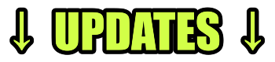

 

To download FLOAT.FILE, download FLOAT.FILE.zip and extract it, then ruin build.bat (just called "build"), to get the .exe!

  Effortlessly display ANY file type on your screen anywhere! 
  Resize and move around your displayed file freely, even with the program closed! 
  Useful for streamers and content creators, or people who just want an image or video on their screen :P 

  <b>//notquiteETERNAL</b> 
  <i>Last updated 7th Nov 2026</i> 

---

 

---

  <b>Fullscreen Optimizations Update | V1.3.0</b> 

  + Fullscreen-optimized games like CS2 should no longer lag FLOAT.FILE 
  Note: GIFs and videos, (mainly videos), may still lag slightly 

  <i>7th Nov 2026</i> 

---

  <b>Memory Usage Update | V1.2.2</b> 

  + Managed to lower memory usage from ~120MB → ~60MB 
  Note: May tweak a bit further lower even more 

  <i>7th Nov 2026</i> 

---

  <b>Source Code Update | V1.2.1</b> 

  + Uploaded full source code! Check the <i>raw</i> folder :P

  <i>7th Nov 2026</i> 

---

  <b>Click-through Update | V1.2.0</b> 

  + Added click-through support (Click the lock icon to enable click-through, right click to change keybind) 

  <i>7th Nov 2026</i> 

---

  <b>Extras Update | V1.1.0</b> 

  + Added alignment buttons 
  + Added opacity setting 
  + Changed logo and logo text color 
  + Optimizations (~100MB RAM → ~80MB RAM) 

  <i>7th Nov 2026</i> 

---

  <b>Initial Release | V1.0.0</b> 

  Just the initial release, nothing to comment on

  <i>6th Nov 2026</i> 

